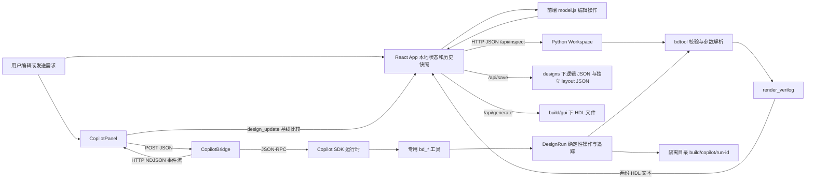

# BD Studio 架构基线

## 记录范围

P0.1，2026-11-11。代码基准提交为 `94c49bda3d65602c758827d023b729d370fe38ba`；以 [实施计划](../IMPLEMENTATION_PLAN.md) 为后续任务书。本阶段只记录事实和运行结果，不修改运行时代码、文件格式或生成模板。以下链接均指仓库中的实际实现。

## 数据流



## 1. 通信与入口

[bdgui.py](../bdgui.py) 使用标准库 `ThreadingHTTPServer`，绑定 `127.0.0.1`，默认端口 8765，冲突时尝试后续端口。静态资源来自 `web/dist/`。没有 WebSocket、数据库或前端开发服务器依赖。Copilot 生成事件通过同一 HTTP 响应的 NDJSON 流传输，约每秒空闲心跳；不是 WebSocket 或 SSE。

| 方法与路径 | 实际职责 |
| --- | --- |
| `GET /`、静态资源路径 | 提供编译后的网页资源 |
| `GET /api/state` | 启动设计、独立布局、诊断及本地请求令牌 |
| `GET /api/designs` | 启动设计、examples/designs 下 JSON 和存在时的 src/ip_catalog.json |
| `GET /api/load?path=...` | 加载工作区内 JSON，源码路径以设计文件目录为基准 |
| `POST /api/inspect` | 调用核心校验，返回 valid、字符串诊断、HDL 文本及解析后的接口 |
| `POST /api/save` | 将草稿保存至 designs，另存布局并重定位源码相对路径 |
| `POST /api/generate` | 严格校验通过后写入 build/gui |
| `GET /api/copilot/status` | 本地被动读取 SDK/连接状态，不发起模型请求 |
| `POST /api/copilot/connect` | 连接 SDK、检查认证、查询可用模型，不发送提示词 |
| `POST /api/copilot/chat` | 接收显式用户消息，返回 NDJSON 流 |
| `POST /api/copilot/cancel` | 中止当前请求 |
| `POST /api/copilot/clear` | 断开并删除应用拥有的会话 |

POST 仅接受 JSON，请求大小为 1 字节至 2 MiB。Host/Origin 和 `X-BD-Token` 检查限制本地调用，路径必须留在工作区。当前没有 multipart 上传或 IP 导入 API。此服务是单用户本地工具，不是公网多用户服务。

## 2. 设计格式与布局

[examples/counter_compare.json](../examples/counter_compare.json) 代表当前格式：顶层严格要求 `name, modules, ports, instances, nets`，不接受额外字段，尚无 `schema_version`。因此不能直接把版本字段插入现有文档而不提供兼容加载。

| 字段 | 实际结构 |
| --- | --- |
| `modules` | 模块名到 `{sources, parameters?, ports}` 的字典，定义内联于设计 |
| `parameters` | 参数名到 `{default, min?, max?}`；默认值和覆盖值是有符号 32 位整数 |
| `ports` | 名称到 `{direction, range?, signed?}`，direction 仅 input/output |
| `instances` | 实例名到 `{module, parameters?}`，覆盖参数用 parameters 而非 params |
| `nets` | 网络名到端点字符串数组，如 `['counter_0.count', 'compare_0.value']` |
| 端点 | `instance.port` 或 `@external_port`，不是结构化对象 |

省略 range 表示标量；`[0,0]` 是单比特向量，`[0,7]` 和 `[7,0]` 的索引顺序有意义。位宽为 `abs(left-right)+1`，连接要求范围和符号性一致，不自动重排、截断或补位。

布局通过 `Path.with_suffix('.layout.json')` 定位，含 nodes 字典 `{实例名或@端口名: {x,y}}` 及 viewport `{x,y,zoom}`。`check_layout` 限制数值有限和缩放范围。画布位置不进入硬件 JSON。序列化保留字典插入顺序，不按名称全局排序；源码路径在另存时调整。

## 3. IP 目录与源码

计数器和比较器接口是手工元数据，原始源码在 [examples/rtl](../examples/rtl/counter.v)。没有任意 Verilog/SystemVerilog 解析器、IP-XACT 提取或模块体自动扫描。

[src/ip_catalog.json](../src/ip_catalog.json) 是含 5 个模块定义的空白设计：uart_tx、uart_rx、bd_stream_register、axis_register、priority_encoder。[src/UPSTREAM.json](../src/UPSTREAM.json) 记录上游许可与源码哈希；四份 vendor RTL 保留 MIT 声明，本地适配层另存。部分 profile 固定宽度，不等价于支持上游的全部参数空间。详情见 [src/README.md](../src/README.md)。

[bdworkflow.py](../bdworkflow.py) 的 `read_catalog` 合并当前定义与项目目录，返回定义/源码哈希和冲突；当前设计同名定义优先。不存在版本化 ip_library、检索索引、角色推断或接口分组。

## 4. 校验和生成规则

[bdtool.py](../bdtool.py) 的 `load_design -> validate_design -> render_verilog` 是 CLI 与 GUI 的共享核心。解析 JSON 时拒绝重复键；源码存在性检查依赖文件系统，校验还不是接受显式 library 的纯函数。

已有检查：

- JSON 对象类型、必需/未知字段、重复键、合法 Verilog-2005 标识符和关键字。
- 生成模块名与 IP 模块名冲突；外部端口、实例、网络共用名字域；模块参数与端口同名。
- 模块和端点存在、源码文件存在、未知参数、参数整数类型与 min/max。
- 范围 AST 白名单：整数、参数名、括号、一元正负、加减乘；拒绝未解析参数、非法表达式及溢出。没有除法、幂、三目或 `$clog2` 支持。
- 每端点只属于一网，每网至少两个端点，驱动端恰好一个。外部 input 和实例 output 驱动；实例 input 和外部 output 接收。
- 接收端位宽、范围和符号性匹配；全部实例输入、外部输出必须连接。未使用实例输出可以悬空，无 warning。
- 允许时序反馈，不按图有环直接拒绝；不做组合环路、CDC、复位极性、协议、地址或时序分析。

诊断为第一个抛出的 `DesignError` 字符串，没有 E001 等稳定码、结构化 location 或自动 fix。GUI 的 `inspect` 在整体失败时仍尝试独立解析端口；前端通过消息文本匹配定位对象。

生成器返回 `{文件名:文本}`，按输入声明顺序输出 Verilog-2005、LF 换行及尾换行。BD 层输出 wire、外部 assign、参数绑定和实例；wrapper 仅使用 BD 名和外部端口，内部实例名有碰撞避让。输出阶段在目标目录暂存再逐文件替换；有输入文件覆盖保护，但多文件写入不是事务。当前没有代码头、source map、SystemVerilog 输出开关或 XDC。

## 5. 前端状态和界面

[web/src/App.jsx](../web/src/App.jsx) 使用 React `useState` 和 refs：`history={past,current:{design,layout},future}`。无应用级 Redux/Zustand store；React Flow 自身内部状态及依赖不能等同于应用状态架构。编辑通过 `mutate` 克隆整个快照，历史上限 80，不是 Immer patches。

[web/src/model.js](../web/src/model.js) 提供前端编辑操作和连线预检；后端是最终权威。参数变化/设计变化后 180 ms 防抖调用 inspect。当前没有增量校验、大图基准、分层设计或 i18n 资源；中文与英文文案散布在组件/工具中。

[CircuitEdge.jsx](../web/src/CircuitEdge.jsx) 使用同步正交避障；[OutputWindow.jsx](../web/src/OutputWindow.jsx) 使用 react-rnd 实现停靠、浮动、缩放和最大化，代码为 pre/textarea，非虚拟化编辑器。数据流图布局和连线路径不改变硬件连接。

## 6. AI 调用与输出

[CopilotPanel.jsx](../web/src/CopilotPanel.jsx) 手动发送 prompt/model/conversation_id 和当前 JSON/base_dir；按此前用户设置，confirm_usage、share_context、allow_design_changes 固定 true 且控件隐藏。打开页面不发送模型请求。

[bdcopilot.py](../bdcopilot.py) 可选加载 SDK 1.0.28，通过 JSON-RPC 管理 Copilot 运行时。单独 asyncio 线程拥有会话；采用 copilot-cli 模式读取当前用户凭据，工作目录隔离。内置 shell/file/network/MCP 工具禁用，仅注册九个 bd_* 工具；指定项目 skill 显式加入 system_message。不是 OpenAI 兼容 LLMClient 接口。

工具为 bd_design、bd_validate、bd_preview、bd_workflow、bd_catalog、bd_read_source、bd_requirements、bd_plan、bd_generate。`DesignRun` 先检查真实用户原话、需求 ID、阻塞问题和审查义务，再通过 `apply_operations` 执行副本、校验及隔离生成。每回合最多 24 个工具调用、3 次计划尝试、180 秒；每会话最多 20 条消息。停止会主动 abort，失败时强制停止自有运行时。

流事件包括 start、delta、message、tool、workflow、design_update、error、done 及 ping。`design_update` 含原设计、候选设计、base_dir、diff、产物路径及验证状态。当前画布在基线匹配时自动应用并进入撤销历史；并发修改拒绝覆盖。这与新计划 P3.5 的“先预览后确认”不同，留待该任务显式迁移。需求追踪不等于功能仿真已通过。

## 7. 测试、CI 与执行记录

初始测试使用 Python 标准库 unittest；CopilotClient/FakeSession 为可替换 SDK 工厂替身，没有真实 LLM/网络依赖。HTTP 测试只访问回环测试服务。Icarus 不存在时 HDL 测试显式 skip；存在时实际编译仿真。前端采用 Node 内置 node:test，当前 19 个纯逻辑测试；浏览器曾人工自动化验证，但仓库没有持久化 Playwright 测试入口。

初始没有 GitHub Actions workflow、pytest 配置、Python lint、前端 lint/typecheck 脚本。package scripts 只有 test/build。P0.2 建立磁盘 golden，P0.3 建立统一测试与 lint/typecheck 门禁；此处不把缺少门禁记成通过。

在项目根目录执行（Windows PowerShell，使用项目 venv）：

```powershell
.\.venv\Scripts\python.exe -m unittest discover -s tests -v
node --test web/src/model.test.js web/src/copilot.test.js
npm.cmd --prefix web run build
.\.venv\Scripts\python.exe -m bdtool validate examples/counter_compare.json
.\.venv\Scripts\python.exe -m bdtool generate examples/counter_compare.json -o build/p0-baseline
.\.venv\Scripts\python.exe -m bdgui --port 0
```

`--port 0` 让系统选择空闲端口，服务会打印 URL；Ctrl+C 停止。Linux/macOS 使用 `.venv/bin/python` 和 npm。安装见 [README](../README.md)。

2026-11-11 本轮实际运行结果：

| 检查 | 结果 |
| --- | --- |
| Python unittest | 49 项通过，0 失败/错误/跳过，29.501 秒；包含实际 Icarus 检查 |
| Node 前端单测 | 19 项通过，0 失败/跳过 |
| Vite 生产构建 | 通过，Vite 7.3.7；React Flow use-client 提示与 500 KB 包体积告警仍存在 |
| CLI validate | `Valid: example_bd (2 instances, 4 nets)` |
| CLI generate | build/p0-baseline 下产生 example_bd.v 与 example_bd_wrapper.v |
| GUI 启动 | 系统选择端口 64533；页面及 /api/state 请求成功，design=example_bd、valid=true、两份 HDL 预览 |
| 运行时代码修改 | 无；未调用真实 Copilot 模型 |

本阶段结论：P0.1 待核实项均已回答，现有命令可运行。P0.2 的磁盘 golden 和 P0.3 的 lint/typecheck/CI 尚未建立，不把它们报告为完成。